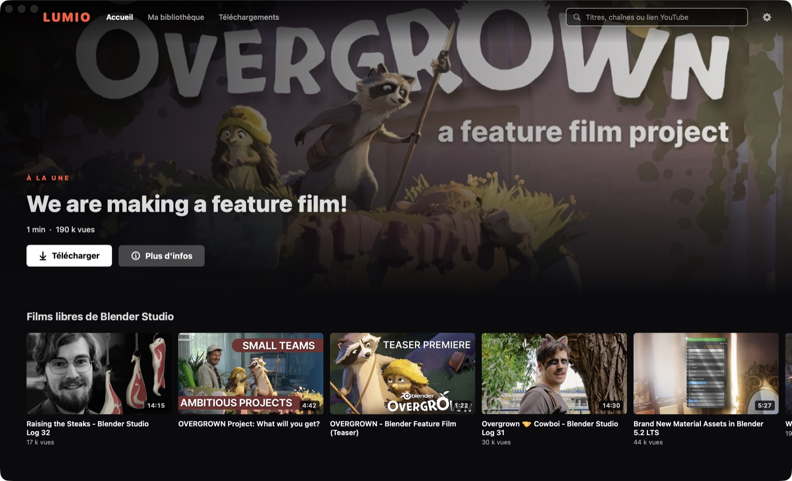
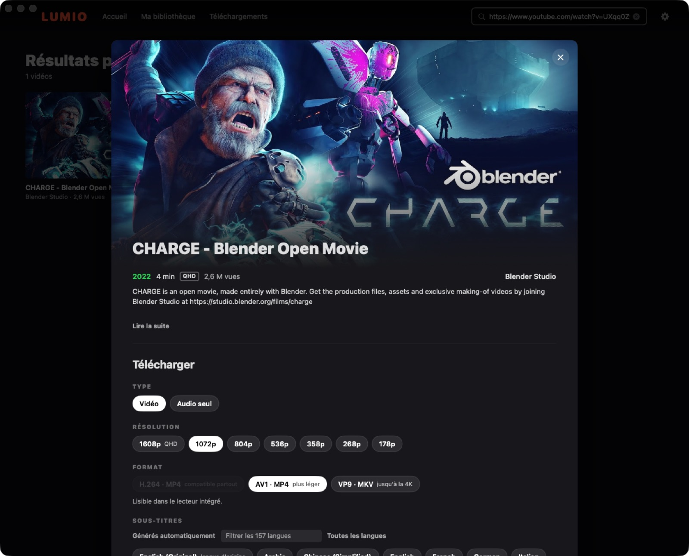
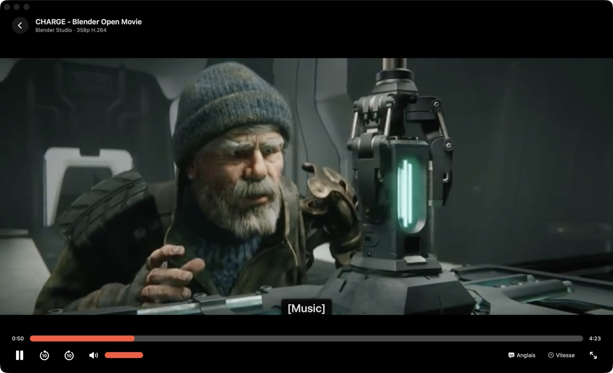

<div align="center">


<h1></h1>

**Un client YouTube local pour macOS, pensé comme une plateforme de streaming.**

Parcourez un catalogue en rangées, regardez tout de suite en streaming ou téléchargez
dans le format de votre choix pour regarder hors ligne.




</div>

## Fonctionnalités

| | |
|---|---|
| **Accueil en rangées** | Une bannière « À la une », puis des rangées horizontales par thème, modifiables dans les réglages. |
| **Catégories** | Un onglet pour explorer par thème (documentaires, histoire, musique live…) ou par chaîne (ARTE, France Culture, CNRS…). |
| **Recherche** | Par mots-clés, ou en collant le lien d'une vidéo, d'une playlist ou d'une chaîne. |
| **Films et séries du disque** | Lumio analyse vos dossiers, range vos fichiers par série et par saison, et les lit, MKV compris. Chaque œuvre a sa fiche, avec synopsis et genres. |
| **Lecture immédiate** | Un bouton « Regarder » lit la vidéo en streaming, sans rien télécharger, avec reprise là où vous vous êtes arrêté. |
| **Téléchargement à la carte** | Vidéo ou audio seul, résolution jusqu'à la 4K/8K, codec, piste audio doublée, sous-titres, chapitres. |
| **Bibliothèque hors ligne** | Tout ce qui est téléchargé se lit sans connexion, avec reprise là où vous vous êtes arrêté. |
| **Lecteur intégré** | Commandes épurées, panneaux Audio et Sous-titres, choix de l'épisode, enchaînement automatique, vitesse, qualité en streaming, plein écran, lecteur réduit et raccourcis clavier. |
| **Abonnements et « À regarder plus tard »** | Suivez des chaînes pour retrouver leurs dernières vidéos sur l'accueil, et mettez des vidéos de côté. |
| **Affiches (TMDB), en option** | Avec une clé TMDB gratuite : affiches, images de fond et résumés d'épisodes pour vos films et séries. |
| **Claude, en option** | Avec votre clé API : des rangées « Pour vous » d'après ce que vous regardez, et les synopsis de vos films et séries. |
| **Espace disque** | Ce que Lumio occupe, vidéos triées par taille, suppression des vidéos déjà vues, vidage du cache. |
| **File d'attente** | Progression, débit, temps restant et annulation, deux téléchargements à la fois. |

### Choisir le format, la résolution et les sous-titres



Lumio lit les formats réellement proposés pour chaque vidéo et n'affiche que ceux qui existent.

| Option | Choix |
|---|---|
| Type | Vidéo, ou audio seul |
| Résolution | Toutes celles de la vidéo, de 144p à la 4K/8K |
| Codec vidéo | H.264 (MP4), AV1 (MP4), VP9 (MKV) |
| Format audio | M4A, MP3, Opus, FLAC |
| Piste audio | Originale ou doublée, quand la vidéo en propose plusieurs |
| Sous-titres | Pistes manuelles et automatiques, plusieurs langues à la fois |
| Extras | Miniature et métadonnées intégrées, chapitres, retrait des segments sponsorisés |

### Regarder, en streaming ou hors ligne

Le bouton **Regarder** lance la lecture immédiatement : Lumio demande à YouTube son flux adaptatif
et le confie au lecteur système. La qualité s'ajuste au débit, jusqu'en 1080p, et se plafonne depuis
le lecteur. Les sous-titres se chargent à la demande. Une vidéo téléchargée se lit, elle, sans
connexion et dans la résolution choisie, 4K comprise.



| Touche | Action |
|---|---|
| `Espace` | Lecture / pause |
| `←` `→` | Reculer / avancer de 10 secondes |
| `↑` `↓` | Volume |
| `F` | Plein écran |
| `Échap` | Fermer le panneau ouvert, puis quitter le plein écran, puis le lecteur |


### Abonnements et vidéos mises de côté

- **Abonnements** : depuis la fiche d'une vidéo ou par un clic droit sur une carte, abonnez-vous à sa
  chaîne. L'accueil affiche alors une rangée « Abonnements » avec les dernières vidéos de vos chaînes,
  triées par date, et l'onglet Catégories liste vos chaînes. Aucun compte YouTube n'est nécessaire :
  la liste reste sur votre Mac.
- **À regarder plus tard** : le signet de la fiche, ou le clic droit sur une carte, met une vidéo de
  côté. Elle apparaît dans une rangée dédiée de l'accueil.

### Lecteur réduit

Le bouton à gauche du plein écran détache la vidéo dans une petite fenêtre flottante, qui reste
au-dessus des autres. La fenêtre principale redevient alors utilisable pour parcourir l'app. Au survol,
la petite fenêtre affiche une barre de progression cliquable, lecture et pause, les sauts de dix
secondes, le retour au lecteur et la fermeture ; les sous-titres y restent affichés. Elle se déplace,
se redimensionne en gardant son format, et retient sa place. L'épisode suivant, ou une autre vidéo
lancée depuis l'app, continue dans cette même petite fenêtre.

### Aperçu au survol et espace disque

- **Aperçu** : en survolant la barre de progression, une vignette montre l'image à l'endroit pointé.
  Elle existe pour les fichiers téléchargés et les films et séries du disque ; en streaming, seule
  l'heure pointée s'affiche, macOS ne sachant pas extraire d'image d'un flux.
- **Espace disque** (dans les réglages) : la place occupée par vos téléchargements, triés par taille,
  avec la mise à la corbeille des vidéos vues jusqu'au bout, et le vidage du cache. Vos films et séries
  y figurent pour information seulement : Lumio ne les supprime jamais.

### Suggestions par Claude (en option)

Lumio peut demander à [Claude](https://www.anthropic.com/claude) trois rangées « Pour vous » : deux qui
prolongent vos goûts, une découverte. Chaque rangée indique pourquoi elle vous est proposée.

Les suggestions sont **désactivées par défaut**. Pour les activer, ouvrez **Réglages → Suggestions par Claude**,
collez une clé API Anthropic (à créer sur [console.anthropic.com](https://console.anthropic.com)) et
activez l'interrupteur.

- **Ce qui est envoyé à l'API d'Anthropic** : les titres et chaînes de votre bibliothèque et de votre
  historique de lecture (30 au plus), votre avancement dans chaque vidéo et vos recherches récentes. Rien d'autre, et rien tant que la
  fonction est désactivée.
- **La clé** est stockée dans le Trousseau de macOS. Après une recompilation, macOS peut redemander
  l'autorisation d'y accéder, car la signature locale de l'app change.
- **Le coût** est facturé sur votre clé. Lumio ne rappelle l'API que si la liste de vos vidéos ou de vos recherches a changé,
  au plus une fois par heure, ou quand vous cliquez sur « Actualiser les suggestions ».
- Claude propose des recherches, pas des vidéos : c'est yt-dlp qui remplit ensuite chaque rangée.

### Films et séries déjà sur votre disque

L'onglet **Films et séries** présente les vidéos que vous possédez déjà, rangées comme sur une
plateforme : une page par série, ses saisons, la liste des épisodes avec vignette, durée et
progression, un bouton « Reprendre » et l'épisode suivant dans le lecteur. Chaque série et chaque
film s'ouvre dans une fiche : bandeau, bouton de lecture, synopsis, genres, saisons et épisodes.

- **Analyse** : Lumio parcourt les dossiers Téléchargements et Vidéos, plus ceux que vous ajoutez dans
  les réglages. Il reconnaît les épisodes d'après leur nom (`S01E02`, `1x02`, dossier « Saison 1 »…),
  regroupe les doublons et ignore les vidéos personnelles (photos, captures d'écran).
- **Lecture seule** : vos fichiers ne sont jamais déplacés, renommés ni supprimés.
- **Lecture des MKV** : macOS ne lit pas ce format. Lumio recopie donc l'épisode dans un fichier
  temporaire lisible, sans réencoder la vidéo, ce qui prend une à deux secondes. Au passage, chaque
  image est recalée sur la grille exacte de sa cadence : un MKV horodate à la milliseconde, ce qui
  donnerait sinon une lecture légèrement saccadée. Les deux dernières
  copies sont gardées dans le cache, les autres sont effacées.
- **Sur l'accueil** : une rangée « Reprendre vos films et séries » relance d'un clic l'épisode en cours.
- **Dans le lecteur** : un panneau liste les épisodes de la série et permet d'en changer sans quitter
  la lecture ; à la fin d'un épisode, le suivant démarre après un compte à rebours annulable
  (désactivable dans les réglages).
- **Pistes audio et sous-titres** : le lecteur propose les langues du fichier (version originale,
  version française…) et ses sous-titres texte. Les sous-titres en image (PGS, VobSub) ne sont pas
  pris en charge.
- **Vignettes** : elles sont tirées des fichiers eux-mêmes, ou de l'affiche qu'ils contiennent.
- **Descriptions par Claude** (avec votre clé API) : Claude rédige le synopsis et les
  genres de chaque œuvre. Contrairement aux suggestions, cette option est **active dès qu'une clé est
  enregistrée** : les titres partent à la première analyse, sans clic supplémentaire. Seuls le titre, l'année et le type (film ou série) sont envoyés à l'API
  d'Anthropic, jamais les noms de fichiers ni les chemins. Chaque fiche est mise en cache : un titre
  n'est demandé qu'une fois. Les résumés sont écrits de mémoire par le modèle et peuvent contenir des
  erreurs ; s'il ne reconnaît pas un titre, la fiche reste vide plutôt qu'inventée. L'option se
  désactive dans les réglages.

- **Affiches et résumés d'épisodes (TMDB)**, en option : collez une clé gratuite de
  [themoviedb.org](https://www.themoviedb.org) dans **Réglages → Affiches**. Seuls le titre et l'année
  de chaque œuvre sont envoyés à TMDB. Une affiche n'est retenue que si le titre correspond exactement
  et que l'année concorde ; sinon Lumio garde la vignette tirée du fichier. Si une œuvre n'est pas
  trouvée, ou reconnue à tort, le lien « Choisir l'affiche » de sa fiche ouvre une recherche libre où
  vous désignez vous-même la bonne ; ce choix n'est plus remis en cause. Les résumés d'épisodes ne
  sont appliqués que si la saison de TMDB couvre les numéros d'épisodes présents sur le disque.

Au premier accès, macOS demande d'autoriser Lumio à lire le dossier Téléchargements.

## Installation

### Prérequis

- macOS 14 ou plus récent ;
- Xcode ou les Command Line Tools, pour compiler ;
- [Homebrew](https://brew.sh), pour les outils dont yt-dlp a besoin.

```bash
brew install ffmpeg deno python
```

`ffmpeg` assemble la vidéo et l'audio, `deno` est le moteur JavaScript dont yt-dlp a besoin
pour YouTube, et `python` sert à installer le moteur.

### Construire

```bash
git clone https://github.com/dgadacha/lumio.git
```

```bash
cd lumio && ./scripts/build-app.sh --install
```

Le script compile, assemble `build/Lumio.app`, la signe localement, puis la copie dans
`/Applications`. Sans `--install`, l'app reste dans `build/`.

### Premier lancement

Au premier lancement, Lumio installe sa propre copie de yt-dlp dans un environnement Python
isolé, sans rien modifier d'autre sur le système. Elle est ensuite **mise à jour automatiquement** :
une fois par jour, quand aucun téléchargement n'est en cours, Lumio vérifie et installe la dernière
version. Les téléchargements lancés pendant une mise à jour patientent quelques secondes.

> YouTube change souvent, et un moteur de quelques mois est refusé. La mise à jour automatique
> se désactive dans **Réglages → Moteur de téléchargement**, où un bouton permet aussi de la
> forcer.

## Où sont les données

| Quoi | Où |
|---|---|
| Vidéos, miniatures et sous-titres `.vtt` | `~/Movies/Lumio/` (modifiable dans les réglages) |
| Index de la bibliothèque, historique et positions de lecture, fiches rédigées par Claude | `~/Library/Application Support/Lumio/` |
| Copies temporaires des MKV, vignettes et sous-titres extraits | `~/Library/Caches/Lumio/` |
| Copie privée de yt-dlp | `~/Library/Application Support/Lumio/engine/` |

Supprimer un titre depuis la bibliothèque déplace son dossier dans la corbeille.

## Sous le capot

Lumio est une app SwiftUI native, sans dépendance Swift externe. Elle lance `yt-dlp` comme
processus et lit ses sorties : JSON pour la recherche et les formats, lignes de progression
pour les téléchargements.

| Fichier | Rôle |
|---|---|
| `Engine.swift` | Appels yt-dlp (recherche, formats, mise à jour du moteur) et lecture des sous-titres WebVTT |
| `Models.swift` | Modèles, et traduction des options en arguments yt-dlp |
| `Claude.swift` | Appels à l'API Claude (suggestions, fiches des films et séries) et stockage de la clé dans le Trousseau |
| `Stores.swift` | Bibliothèque, file de téléchargements, état de l'app |
| `Categories.swift` | Catalogue des catégories (thèmes et chaînes), onglet et page d'une catégorie |
| `Browse.swift` | Accueil, rangées, recherche, bibliothèque, téléchargements |
| `Detail.swift` | Fiche d'une vidéo et options de téléchargement |
| `MediaParser.swift` | Classement des fichiers en séries, saisons, épisodes et films, d'après leur nom |
| `Collections.swift` | Listes de l'utilisateur : vidéos à regarder plus tard, chaînes suivies et leur fil |
| `Artwork.swift` | Affiches, images de fond et résumés d'épisodes via l'API de TMDB, clé dans le Trousseau |
| `LocalMedia.swift` | Analyse des dossiers, préparation à la lecture (ffmpeg), vignettes, positions, cache des fiches |
| `LocalViews.swift` | Onglet Films et séries, fiche d'une série ou d'un film |
| `Player.swift` | Lecteur, pour un fichier local comme pour un flux |
| `Settings.swift` | Réglages |
| `Debug.swift` | Pilote de test, inactif sans la variable `LUMIO_DEBUG` |

L'icône est dessinée par `scripts/make-icon.swift`.

## Limites connues

- **Le streaming plafonne à 1080p.** Au-delà, YouTube ne sert que du VP9, que macOS ne lit pas :
  pour la 4K, téléchargez. Le lien du flux expire au bout de quelques heures ; il suffit de rouvrir
  la vidéo.
- **Le VP9 ne se lit pas dans l'app.** macOS ne le décode pas dans ce conteneur ; ces
  fichiers s'ouvrent dans votre lecteur par défaut (VLC, IINA). La fiche le signale avant
  le téléchargement. L'AV1 demande une puce qui le décode matériellement.
- **Les sous-titres peuvent être refusés.** YouTube limite leur débit, surtout pour les
  traductions automatiques. Lumio retente deux fois, puis indique les pistes manquantes.
- **L'accueil repose sur des recherches.** YouTube n'expose plus de flux « tendances »
  sans compte.
- **App non notarisée.** Elle est signée localement : compilez-la sur le Mac où vous
  l'utilisez.

## Usage responsable

Lumio est un outil personnel. Ne téléchargez que des contenus dont vous détenez les droits,
qui sont sous licence libre, ou dont l'ayant droit autorise la copie, et respectez les
conditions d'utilisation de YouTube. Lumio n'est affilié ni à YouTube ni à Google.

## Licence

Le code de Lumio est distribué sous [licence MIT](LICENSE). yt-dlp et FFmpeg, que Lumio appelle
sans les inclure, restent soumis à leurs propres licences.

## Crédits

- Affiches, images de fond et résumés d'épisodes : [TMDB](https://www.themoviedb.org).
  This product uses the TMDB API but is not endorsed or certified by TMDB.
- [yt-dlp](https://github.com/yt-dlp/yt-dlp) et [FFmpeg](https://ffmpeg.org) font le gros du travail.
- Les captures d'écran montrent des films et vidéos de [Blender Studio](https://studio.blender.org),
  dont *CHARGE*, © Blender Foundation, diffusé sous licence Creative Commons Attribution.
