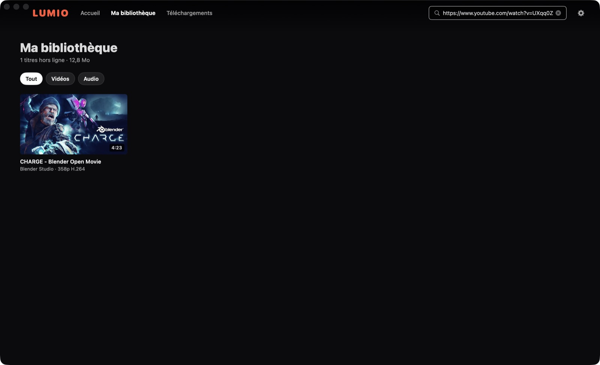

<div align="center">


# Lumio

**Un client YouTube local pour macOS, pensé comme une plateforme de streaming.**

Parcourez un catalogue en rangées, téléchargez dans le format de votre choix,
puis regardez hors ligne dans le lecteur intégré.


</div>

## Fonctionnalités

| | |
|---|---|
| **Accueil en rangées** | Une bannière « À la une », puis des rangées horizontales par thème, modifiables dans les réglages. |
| **Recherche** | Par mots-clés, ou en collant le lien d'une vidéo, d'une playlist ou d'une chaîne. |
| **Téléchargement à la carte** | Vidéo ou audio seul, résolution jusqu'à la 4K/8K, codec, piste audio doublée, sous-titres, chapitres. |
| **Bibliothèque hors ligne** | Tout ce qui est téléchargé se lit sans connexion, avec reprise là où vous vous êtes arrêté. |
| **Lecteur intégré** | Sous-titres, vitesse de lecture, plein écran et raccourcis clavier. |
| **File d'attente** | Progression, débit, temps restant et annulation, deux téléchargements à la fois. |

### Choisir le format, la résolution et les sous-titres


Lumio lit les formats réellement proposés pour chaque vidéo et n'affiche que ceux qui existent.

| Option | Choix |
|---|---|
| Type | Vidéo, ou audio seul |
| Résolution | Toutes celles de la vidéo, de 144p à la 4K/8K |
| Codec vidéo | H.264 (MP4), AV1 (MP4), VP9 (MKV) |
| Format audio | M4A, MP3, Opus, FLAC |
| Piste audio | Originale ou doublée, quand la vidéo en propose plusieurs |
| Sous-titres | Pistes manuelles et automatiques, plusieurs langues à la fois |
| Extras | Miniature et métadonnées intégrées, chapitres, retrait des segments sponsorisés |

### Regarder hors ligne


| Touche | Action |
|---|---|
| `Espace` | Lecture / pause |
| `←` `→` | Reculer / avancer de 10 secondes |
| `↑` `↓` | Volume |
| `F` | Plein écran |
| `Échap` | Quitter le plein écran, puis le lecteur |



## Installation

### Prérequis

- macOS 14 ou plus récent ;
- Xcode ou les Command Line Tools, pour compiler ;
- [Homebrew](https://brew.sh), pour les outils dont yt-dlp a besoin.

```bash
brew install ffmpeg deno python
```

`ffmpeg` assemble la vidéo et l'audio, `deno` est le moteur JavaScript dont yt-dlp a besoin
pour YouTube, et `python` sert à installer le moteur.

### Construire

```bash
git clone https://github.com/dgadacha/lumio.git
```

```bash
cd lumio && ./scripts/build-app.sh --install
```

Le script compile, assemble `build/Lumio.app`, la signe localement, puis la copie dans
`/Applications`. Sans `--install`, l'app reste dans `build/`.

### Premier lancement

Au premier lancement, ouvrez **Réglages → Moteur de téléchargement** et cliquez sur
**Installer la dernière version**. Lumio installe sa propre copie de yt-dlp dans un
environnement Python isolé, sans rien modifier d'autre sur le système.

> YouTube change souvent. Si les téléchargements échouent du jour au lendemain,
> le premier réflexe est de mettre à jour le moteur depuis les réglages.

## Où sont les données

| Quoi | Où |
|---|---|
| Vidéos, miniatures et sous-titres `.vtt` | `~/Movies/Lumio/` (modifiable dans les réglages) |
| Index de la bibliothèque et cache de l'accueil | `~/Library/Application Support/Lumio/` |
| Copie privée de yt-dlp | `~/Library/Application Support/Lumio/engine/` |

Supprimer un titre depuis la bibliothèque déplace son dossier dans la corbeille.

## Sous le capot

Lumio est une app SwiftUI native, sans dépendance Swift externe. Elle lance `yt-dlp` comme
processus et lit ses sorties : JSON pour la recherche et les formats, lignes de progression
pour les téléchargements.

| Fichier | Rôle |
|---|---|
| `Engine.swift` | Appels yt-dlp (recherche, formats, mise à jour du moteur) et lecture des sous-titres WebVTT |
| `Models.swift` | Modèles, et traduction des options en arguments yt-dlp |
| `Stores.swift` | Bibliothèque, file de téléchargements, état de l'app |
| `Browse.swift` | Accueil, rangées, recherche, bibliothèque, téléchargements |
| `Detail.swift` | Fiche d'une vidéo et options de téléchargement |
| `Player.swift` | Lecteur hors ligne |
| `Settings.swift` | Réglages |
| `Debug.swift` | Pilote de test, inactif sans la variable `LUMIO_DEBUG` |

L'icône est dessinée par `scripts/make-icon.swift`.

## Limites connues

- **Pas de lecture en streaming.** YouTube refuse ses flux directs au lecteur système :
  on télécharge, puis on regarde.
- **Le VP9 ne se lit pas dans l'app.** macOS ne le décode pas dans ce conteneur ; ces
  fichiers s'ouvrent dans votre lecteur par défaut (VLC, IINA). La fiche le signale avant
  le téléchargement. L'AV1 demande une puce qui le décode matériellement.
- **Les sous-titres peuvent être refusés.** YouTube limite leur débit, surtout pour les
  traductions automatiques. Lumio retente deux fois, puis indique les pistes manquantes.
- **L'accueil repose sur des recherches.** YouTube n'expose plus de flux « tendances »
  sans compte.
- **App non notarisée.** Elle est signée localement : compilez-la sur le Mac où vous
  l'utilisez.

## Usage responsable

Lumio est un outil personnel. Ne téléchargez que des contenus dont vous détenez les droits,
qui sont sous licence libre, ou dont l'ayant droit autorise la copie, et respectez les
conditions d'utilisation de YouTube. Lumio n'est affilié ni à YouTube ni à Google.

## Crédits

- [yt-dlp](https://github.com/yt-dlp/yt-dlp) et [FFmpeg](https://ffmpeg.org) font le gros du travail.
- Les captures d'écran montrent des films et vidéos de [Blender Studio](https://studio.blender.org),
  dont *CHARGE*, © Blender Foundation, diffusé sous licence Creative Commons Attribution.
